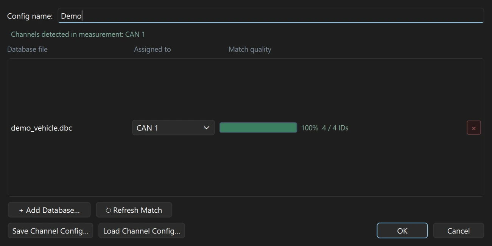
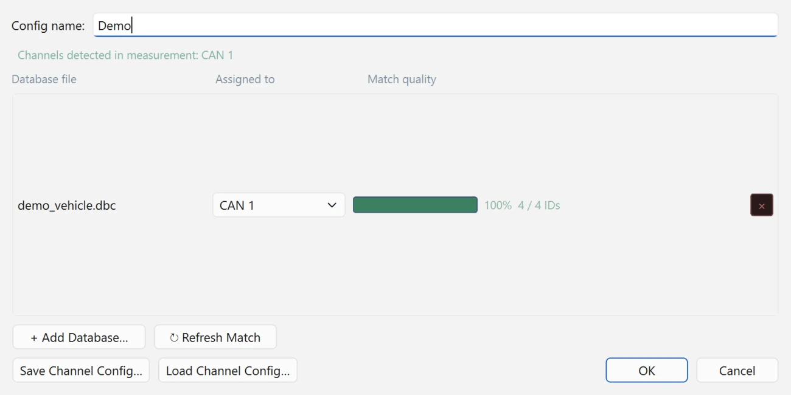

A raw bus log needs a database for each channel. The database says which frames carry which signals, and how to turn the bytes into values.

## Assign databases to channels

Click **Databases**. The Database Manager lists the channels it found in the measurement.

<video class="clip" autoplay loop muted playsinline preload="metadata" aria-label="Databases is clicked, a database is added for CAN 1, its match quality appears, and OK closes the window">
  <source src="/clips/databases-light.mp4" type="video/mp4" media="(prefers-color-scheme: light)">
  <source src="/clips/databases-dark.mp4" type="video/mp4">
</video>

1. Click **+ Add Database…** and choose your DBC, ARXML or LDF files.
2. Under **Assigned to**, choose the channel each database belongs to.
3. Check **Match quality** for each one.
4. Click **OK**.

## Which database for which bus

| Bus | Database formats |
|---|---|
| CAN | DBC or ARXML |
| LIN | LDF |

Formats can be mixed: one channel can use a DBC and another an ARXML.

## One database for every channel

**All CAN** (or **All LIN**) applies a database to every channel of that bus that has no database of its own. Use it when the same database describes all the channels, or as a fallback beside channel-specific ones.

## Match quality

**Match quality** shows how well a database fits the frames on its channel. A low match usually means the wrong channel or the wrong database. Fix it before you decode: a message that no database describes is not decoded.

## Reuse an assignment

- **Save Channel Config…** saves the assignment of databases to channels.
- **Load Channel Config…** restores it in one step, for the next measurement from the same vehicle or bench.

A [configuration](/products/bus-log-analyzer/help/configurations-and-sessions/) also keeps the database mapping, together with the measurement and the plot layout.

## Files that need no database

An MF4, MDF or CSV file that holds decoded signals needs no database. Skip this step and [decode](/products/bus-log-analyzer/help/decode-and-find-signals/).
