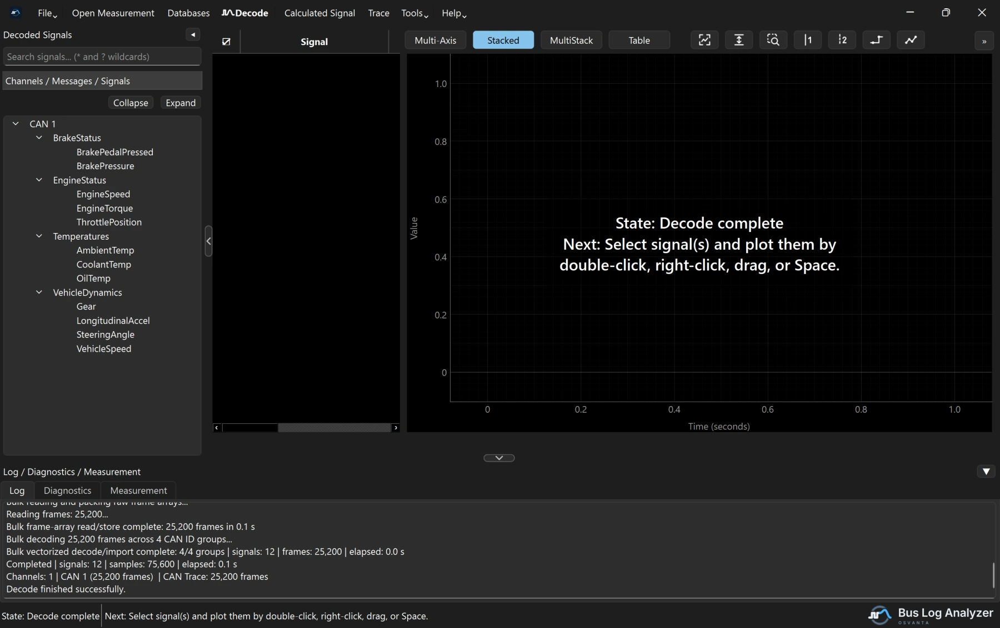
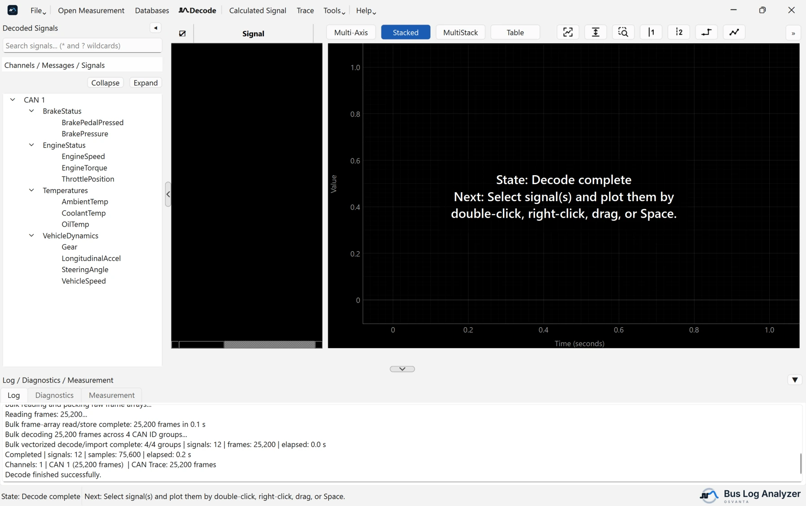

## Decode

Click **Decode** (`F9`). The status bar shows the progress, and the **Log** panel below the plot reports what was read, for example how many message groups were decoded.

When it is done, the signal tree on the left lists every channel, message and signal.

## Search the tree

Type in **Search signals…** above the tree.

- The text can be anywhere in the name, in any case.
- `*` stands for any text and `?` for one character, so `veh*speed` finds VehicleSpeed.
- A search hides every signal that does not match. Clear the box to see them all again.

## Move around the tree

| Key | Action |
|---|---|
| `Ctrl+Shift+-` | Collapse every message |
| `Ctrl+Shift++` | Expand every message |
| `Space` | Plot the selected signals |

Select several signals with Ctrl+click or Shift+click to plot them together.

## Signal properties

Right-click a signal in the tree, or in the signal table, and choose **Properties…** to see what its database says about it:

- its message and ID, and the channel;
- start bit, length, byte order and type;
- factor, offset, range and unit;
- multiplexing, value table and comment;
- the database file it came from.

**Copy** puts it all on the clipboard, which is useful for a problem report.

## If a signal is missing

- Check the search box: a search hides every signal that does not match.
- Check **Databases**: a message that no database describes is not decoded.
- See [Troubleshooting](/products/bus-log-analyzer/help/troubleshooting/).

## Next

[Plot the signals](/products/bus-log-analyzer/help/plotting/).
