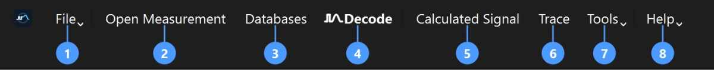

## Install

1. Open the [latest release](https://github.com/osvanta/bus-log-analyzer/releases/latest) and download the file ending in `_Windows.zip`.
2. Extract it to a folder you can write to, such as one in your Documents. Administrator rights are not needed.
3. Run `BusLogAnalyzer.exe`.

There is nothing to install, and no Python is needed.

> **Windows protected your PC.** The application is not code-signed yet, so Windows SmartScreen may stop it the first time. Click **More info**, then **Run anyway**.

## Check the download

Each release comes with a `SHA256SUMS.txt` file. In PowerShell, run `Get-FileHash` on the downloaded ZIP: it must print the hash that file lists. Download the application only from the GitHub release page.

## The top row

Everything starts from the row at the top of the window, read from left to right in the order of the work.

| | Item | What it does |
|---|---|---|
| 1 | **File** | Open configuration, Save configuration (`Ctrl+S`), Export plotted signals (`Ctrl+E`), Save decoded measurement as MF4, Measurement info (`Ctrl+I`) |
| 2 | **Open Measurement** | Opens a measurement file (`Ctrl+O`) |
| 3 | **Databases** | Assigns DBC, ARXML and LDF databases to the bus channels |
| 4 | **Decode** | Reads the measurement and decodes it into signals (`F9`) |
| 5 | **Calculated Signal** | Creates a signal calculated from others by a formula |
| 6 | **Trace** | Shows the raw CAN and LIN frames (`Ctrl+Shift+R`) |
| 7 | **Tools** | Convert files: join, cut, resample and convert measurements |
| 8 | **Help** | Getting started (`F1`), the keyboard shortcuts, where to ask a question or report a problem, the log folder, the user survey and About |

Items you cannot use yet are greyed out. The status bar at the bottom of the window always says what to do next.

## The usual order of work

1. [Open a measurement](/products/bus-log-analyzer/help/open-a-measurement/).
2. [Assign databases](/products/bus-log-analyzer/help/databases/), if the file holds raw CAN or LIN frames.
3. [Decode, then find your signals](/products/bus-log-analyzer/help/decode-and-find-signals/).
4. [Plot them](/products/bus-log-analyzer/help/plotting/).
5. [Save a configuration](/products/bus-log-analyzer/help/configurations-and-sessions/) or [export](/products/bus-log-analyzer/help/export-and-convert/).

## Where the application writes

- Logs, settings and the last session go to `%LOCALAPPDATA%\Osvanta\BusLogAnalyzer`. Only you and the computer's administrators can read that folder.
- Temporary working files go to `%TEMP%` and are removed when the measurement is closed.
- Configurations and exports go only where you save them.

To keep the first folder somewhere else, set the environment variable `OSVANTA_DATA_DIR` to that folder. The full list of files is in [Security and data handling](/bus-log-analyzer/security-and-data/).

## Updating and removing

- **Update:** download the new ZIP and extract it to a new folder. The application does not check for updates itself.
- **Remove:** delete the application's folder, and `%LOCALAPPDATA%\Osvanta\BusLogAnalyzer` for its logs and settings. Nothing is written to the registry.
