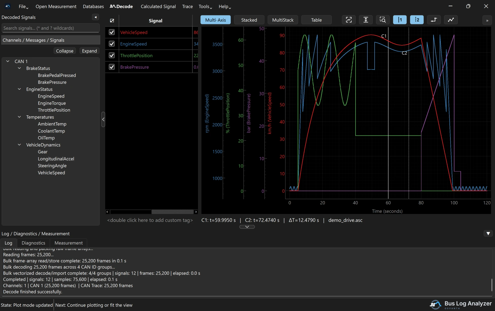
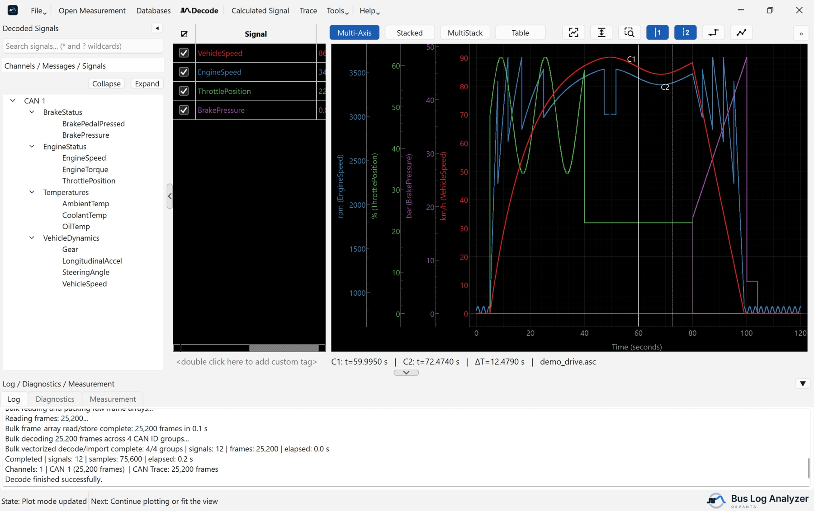

## Plot a signal

Plot a signal from the tree in any of these ways:

- double-click it;
- select one or more and press `Space`;
- drag them onto the plot;
- right-click them and choose **Plot selected signal(s)**.

Plotted signals appear in the **signal table** beside the plot, with their values at the cursors.

## Plot modes

The first buttons above the plot choose the mode.

| Mode | What it shows | Use it when |
|---|---|---|
| **Stacked** (default) | Each signal in its own lane with its own Y scale | You want to compare shapes and timing |
| **Multi-Axis** | The signals over each other, with one axis per unit and an optional axis per signal | You want to compare values on the same scale |
| **MultiStack** | Lanes that each hold several signals | You want related signals together, and groups apart |
| **Table** | The plotted signals as a table beside the plot, a row per sample time | You want to read exact values |

### Working in MultiStack

- Drag signals into a lane to overlay them there.
- The signal table splits to match: each lane gets its own part of the table, level with it, listing only its signals.
- Drag a signal from one part to another to move it to that lane, or within a part to change its order.
- A part with more signals than fit scrolls on its own.
- Signals of a lane whose signals are all unticked are listed under the last lane, so they can be ticked back on.

## Tabs of plots

Each tab above the signal table and the plot has its own signals, signal table, plot mode and Table view.

| To do this | Do this |
|---|---|
| Add a tab | Click **+** |
| Rename a tab | Double-click it |
| Close a tab | Click its small **x**, or use its right-click menu |
| Move between tabs | `Ctrl+Tab` and `Ctrl+Shift+Tab` |
| Plot signals in a tab | Drag them from the tree onto the tab |
| Plot signals in a new tab | Drag them from the tree onto **+** |
| Move plotted signals to another tab | Drag rows from the signal table onto the tab, or right-click them and choose **Move to tab** |

While **Synchronize Tabs**, the chain-link button, is on, as it is at first, every tab shows the same time range and cursors. Markers, measurement events, the signal table's columns and the line mode are the same in every tab.

## Change how a signal looks

Right-click a signal in the signal table to:

- change its colour (`C`);
- give it a line style: solid, dashed, dotted or dash-dot;
- group it with others;
- hide it, or remove it (`Delete`).

Drag rows in the signal table to change the order.

## Line mode and data points

- The line-mode button (`S`) switches between **Step Mode**, the default, where each value is held until the next sample, and **Interpolation Mode**, where straight lines join the samples. The icon shows the mode the plot is in.
- **Show Data Points** marks each sample, with thinner lines.
- **Hide Line** is available while data points are shown, and displays the points without the lines.

Step Mode is the honest picture of a bus signal: the value is only known at each frame, and nothing is known in between.

## Undo

`Ctrl+Z` undoes the last plot action, up to three times.

## Next

[Cursors, zoom and statistics](/products/bus-log-analyzer/help/cursors-zoom-and-statistics/).
