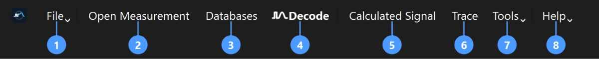
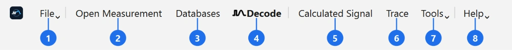

Everything starts from the row at the top of the window. Read it from left to right: it is in the order of the work.

<video class="clip" autoplay loop muted playsinline preload="metadata" aria-label="The pointer moves along the top row, and a caption names what each of its eight items does">
  <source src="/clips/tour-light.mp4" type="video/mp4" media="(prefers-color-scheme: light)">
  <source src="/clips/tour-dark.mp4" type="video/mp4">
</video>

## The top row

| | Item | What it does |
|---|---|---|
| 1 | **File** | Open configuration, Save configuration (`Ctrl+S`), Export plotted signals (`Ctrl+E`), Save decoded measurement as MF4, Measurement info (`Ctrl+I`) |
| 2 | **Open Measurement** | Opens a measurement file (`Ctrl+O`) |
| 3 | **Databases** | Assigns DBC, ARXML and LDF databases to the bus channels |
| 4 | **Decode** | Reads the measurement and decodes it into signals (`F9`) |
| 5 | **Calculated Signal** | Creates a signal calculated from others by a formula |
| 6 | **Trace** | Shows the raw CAN and LIN frames (`Ctrl+Shift+R`) |
| 7 | **Tools** | Convert files: join, cut, resample and convert measurements |
| 8 | **Help** | Getting started (`F1`), the keyboard shortcuts, where to ask a question or report a problem, the log folder, the user survey and About |

Items you cannot use yet are greyed out.

## The rest of the window

- **Decoded Signals**, on the left: the tree of channels, messages and signals, filled by Decode.
- **The signal table and the plot**, in the middle: what you have plotted, in tabs.
- **Log**, at the bottom: what the application read and any warning.
- **The status bar**, at the very bottom: the state, and what to do next. When you are not sure what comes next, read it.

## The usual order of work

1. [Open a measurement](/products/bus-log-analyzer/help/open-a-measurement/).
2. [Assign databases](/products/bus-log-analyzer/help/databases/), if the file holds raw CAN or LIN frames.
3. [Decode, then find your signals](/products/bus-log-analyzer/help/decode-and-find-signals/).
4. [Plot them](/products/bus-log-analyzer/help/plotting/).
5. [Save a configuration](/products/bus-log-analyzer/help/configurations-and-sessions/) or [export](/products/bus-log-analyzer/help/export-and-convert/).

## Next

[Open a measurement](/products/bus-log-analyzer/help/open-a-measurement/).
