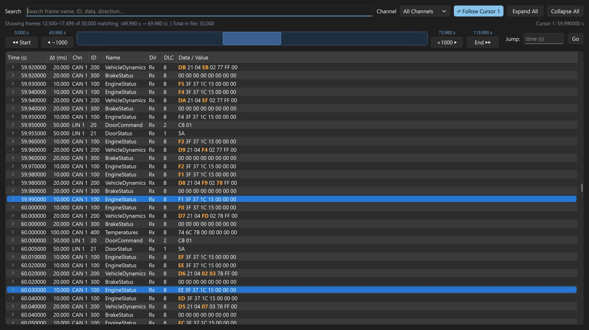
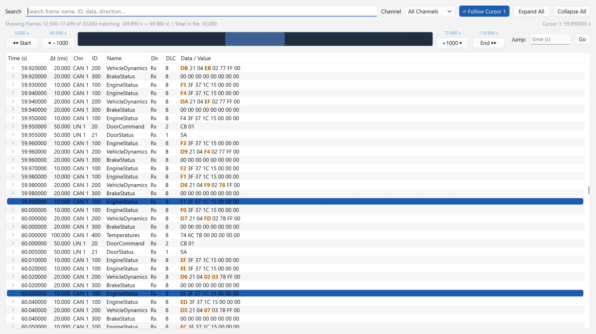

The Trace lists the raw CAN and LIN frames of the measurement, in order. Use it when a signal looks wrong and you want to see the bytes behind it, or to check the timing of a message.

## Open the Trace

<video class="clip" autoplay loop muted playsinline preload="metadata" aria-label="Trace is clicked and the window lists the raw frames, then the pointer shows Follow Cursor 1">
  <source src="/clips/trace-light.mp4" type="video/mp4" media="(prefers-color-scheme: light)">
  <source src="/clips/trace-dark.mp4" type="video/mp4">
</video>

Click **Trace** (`Ctrl+Shift+R`). It is ready once a measurement has been decoded.

The Trace shows raw frames, so it needs a raw bus log. An MF4, MDF or CSV file that holds only decoded signals has no frames to show, and clicking **Trace** says so.

## What the columns tell you

- **Δt** is the time since the previous frame with the same ID on the same channel. A message sent every 10 ms shows about 10 ms in every row; a larger value is a late or missing frame.
- **Changed bytes**: the bytes that changed since that previous frame are bold and coloured, so you see at a glance which part of a message is moving.

Right-click the header to turn either of them off.

## Filter and decode

- Filter the list to the frames you are interested in.
- Decode a frame's signals on demand, to see the signal values that frame carried.

## Follow the plot

While **⇄ Follow Cursor 1** is on, the Trace and the plot move together, both ways:

- picking a frame in the Trace moves Cursor 1 to it;
- moving Cursor 1 on the plot brings its frame into view in the Trace.

This is the quickest way to get from a strange value on the plot to the exact frame that carried it.

## Next

[Calculated signals](/products/bus-log-analyzer/help/calculated-signals/).
